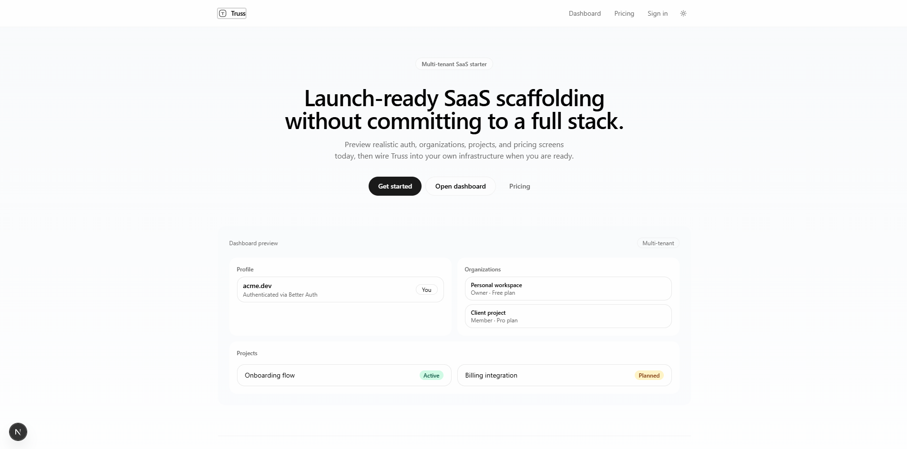
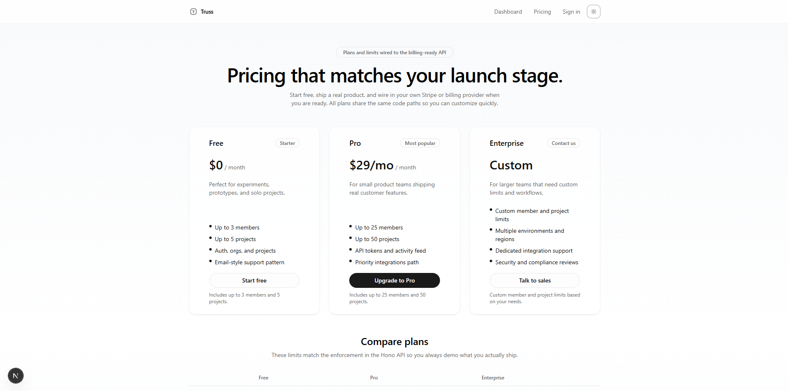
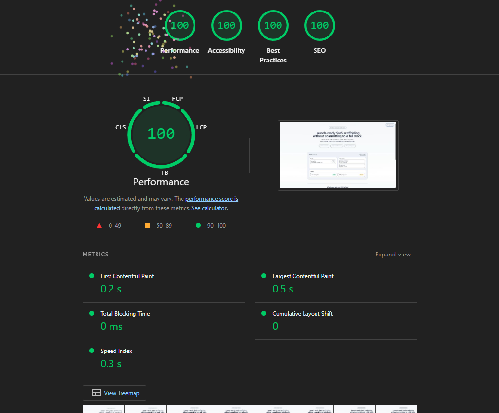

# Truss

Truss is a lightweight, multi-tenant SaaS starter that gives you a clean, opinionated foundation instead of a bloated template.

This repository ships a **Free release** that focuses on a consistent, modern UI surface with realistic SaaS flows, plus the full-stack scaffolding you can enable locally.

It is built with:

- Next.js App Router (apps/saas-web)
- Hono API (apps/api)
- Better Auth
- Drizzle ORM (Postgres)
- Tailwind CSS v4
- Truss UI – small Tailwind-based components (buttons, inputs, cards, badges)
- TanStack Query (`@tanstack/react-query`) for interactive dashboard widgets

The goal of Truss is to provide **architecture and scaffolding** you can customize, not a finished product.

**Live demo:** [truss-web-omega.vercel.app](https://truss-web-omega.vercel.app/) · **Repo:** [github.com/Dendro-X0/Truss](https://github.com/Dendro-X0/Truss)

Need production billing, AI Studio, or admin tools? See **[Strata Pro](https://strata-web-ivory.vercel.app/)** — same architectural DNA, commercial depth.

For a deeper dive into the stack, architecture, and usage, see:

- [`docs/overview.md`](./docs/overview.md)





## Monorepo layout

- `apps/api` – Hono API server
- `apps/saas-web` – Next.js frontend
- `packages/db` – Drizzle schema and DB helper
- `packages/auth` – Better Auth integration
- `packages/email` – email sending + templates (magic link scaffolding)

## Quick start

From the repo root:

```bash
pnpm install
pnpm dev
```

Then open `http://localhost:3000` in your browser.

If you want the full-stack experience locally, configure `.env` first (see below).

## Demo mode

The public deployment of Truss is configured as a **UI-only demo**:

- No `DATABASE_URL`, `BETTER_AUTH_SECRET`, or billing keys are set.
- Auth, invitations, and subscription flows are wired in the codebase but disabled in the demo.

You can enable the same banner used in the demo by setting:

- `NEXT_PUBLIC_TRUSS_DEMO_MODE=1` – shows a dismissible notice on the landing page explaining that the instance is running in demo mode. The dismissal is remembered per browser via `localStorage`.

To run the full stack locally, create a `.env` file from `.env.example` and fill in the required values.

### Dev dashboard bypass

For faster UI iteration, set `DISABLE_AUTH_GUARD=1` (included in `.env.example`). You can open `/user` without signing in; the dashboard shows synthetic demo data. Sign in when you need live API behavior.

Required for local full-stack:

- `DATABASE_URL`
- `BETTER_AUTH_SECRET`
- `NEXT_PUBLIC_API_URL` (default `http://localhost:8787`)
- `AUTH_SESSION_URL` (default `http://localhost:3000/api/auth/get-session`)

## UI primitives and data fetching

Truss ships with a small, Tailwind-based component library used across the auth flows, dashboard, and pricing pages:

- `Button`, `Input`, `Label`, `Card`, `Badge`

These primitives are intentionally minimal so you can replace or extend them with your own design system.

Client-side widgets such as the recent activity feed on `/user` use TanStack Query (`@tanstack/react-query`), wired through a shared `QueryClientProvider` in the Next.js App Router.

## Scripts

From the repo root:

- `pnpm dev` (API + web)
- `pnpm build`
- `pnpm start`
- `pnpm typecheck`
- `pnpm lint`
- `pnpm test:e2e` — all Playwright tests
- `pnpm test:e2e:smoke` — UI smoke tests (no database)
- `pnpm test:e2e:golden` — full golden path (requires database + running dev servers)

Database helpers (Drizzle) live in `packages/db`:

- `pnpm --filter @saas-starter-open/db db:push`
- `pnpm --filter @saas-starter-open/db db:generate`
- `pnpm --filter @saas-starter-open/db db:seed`

## License

MIT — see `LICENSE`.